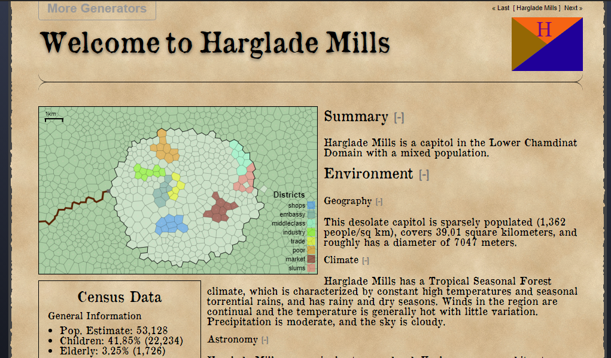

# What is DNDGenerator? #

DNDGenerator is a suite of tools that can help generate a unique campaign setting in seconds. 



# Where did it come From? #
Originally forked from https://github.com/CityGenerator/CityGenerator
We have renamed it to DNDGenerator and now is hosted on www.dungeonmastersvault.com/generator/citygenerator

# How do I run it? #

The site is Perl CGI served by Apache. Everything runs in one container:

```
docker compose up --build -d
```

Then browse http://localhost/generator/ (port 80, `/` redirects to `/generator/`).

CGI pages are sent with `Cache-Control: no-store` — they echo part of the request URL, so a
shared proxy must not keep them — and a request body over 64 KiB is refused with HTTP 413
before any Perl process starts. The cap is there because one unauthenticated 80 MB POST to a
page was measured peaking at 823 MiB of container memory, against 14 MiB idle.

The `--build` is what makes `up` pick up your changes. Without it, `up` reuses the
`dndgenerator:latest` image that already exists, so edits to the code, the `Dockerfile`
or `cpanfile` do nothing.

To stop it:

```
docker compose down
```

# How do I check it? #

```
bash docker/smoke.sh http://localhost:80
```

That fetches the 19 pages the site links and prints one `ok` line for each. It fails —
exit code 1 — on any page that is not HTTP 200, on a body under 1000 bytes, on a body
containing an error string (`Internal Server Error`, `Can't locate`, `Compilation failed`),
on a body with no `</html>` (every page is rendered through `source/Templates/base.tmpl`,
so a 200 without a closing tag is a template that stopped wrapping), and on `/` if it did
not land on `/generator/`.

The suite itself runs on the host, not in the container:

```
cd source && bash ../runtest.sh
```

That runs the 45 suite files (178 tests) on a Debian/WSL2 host that has the apt packages listed
in `Dockerfile`. The shipped image deliberately contains no `tests/` — `Dockerfile` deletes it
after the suite runs there — so the suite also runs at build time, and a red build is diagnosed
from the build log.

Existing Windows checkouts: the repo normalises `*.sh` and `Dockerfile` to LF (`.gitattributes`),
so a checkout made before that needs `git add --renormalize .` once, or `bash runtest.sh` dies on
the first line.

# What do I read when a page is broken? #

```
docker logs dndgenerator
```

Apache's access and error logs are symlinked to the container's stdout and stderr in the
`Dockerfile`, so the cause of a 500 — a missing module, a compile failure, a mod_cgid
complaint — is in the container log, not inside the filesystem.

Log retention is Docker's business, not the app's. This engine logs with the `local`
driver, whose defaults are a 100 MB `max-size` and a bounded number of rotated files; the
`json-file` driver has no size limit at all until you set one. For a long-lived
deployment, cap the logs in `docker-compose.yaml`:

```yaml
services:
  web:
    logging:
      options:
        max-size: "10m"
        max-file: "5"
```

# What are the dependencies? #

The runtime dependencies are apt packages, and the list is the `apt-get install` line in
`Dockerfile`. Six modules have no Debian package at all; they are the six `requires`
lines in `cpanfile`, installed by `cpanm --installdeps` in the same layer. `cpanminus` and
`make` are purged inside that layer, so no compiler or build tool ships in the image.

The test suite runs as part of `docker build`, in two gates: every CGI entry point and every
`lib/*.pm` must compile under taint (`perl -Tc`), then `prove` runs all 45 files in
`source/tests/` (178 tests). A missing dependency therefore fails the build instead of the
first page load. After the suite runs, `tests/` and `puppet/` are deleted from the image so
they cannot be fetched over HTTP.

Taint mode is a compile-time gate, not input validation, and not the XSS defence: `CGI.pm`
untaints the outgoing header, so user-supplied text reaches the HTML no matter what `-T` is
set to. The guard is `source/tests/TestCityPageXSS.pm`, which runs the city page as a child
process and fails if a hostile `?name=` comes back in the output.

The `cpan install ...` one-liner this README used to print was wrong in both directions. It
named `List::MoreUtils`, `Email::Date::Format` and `Test::Harness`, which no code in this
repository imports, and it omitted `CGI`, the XML parser (`XML::Parser`) and `Switch`, all
of which the app relies on. `cpan install` also skips a name it cannot resolve and exits
0, which is why a "successful" build used to ship an image that answered HTTP 500.

# Why did the old container stop working? #

The image was `FROM php`, but this application has never contained PHP: it is Perl CGI.
`php:latest` is now a PHP 8.5 **CLI** image with no Apache in it, and Debian had also moved
`CGI.pm` out of the `perl` package. Every page returned 500.

The image is now `debian:trixie-slim` (pinned by digest) with Apache and Debian's system
Perl: 248 MB, where the previous image was 940 MB – 1.1 GB.

`mod_deflate` is enabled. Every page is generated fresh, so use `?seed=` to make the same
page twice and compare like with like — measured this way, a city page transfers about
22.5% of its plain size (22.3%–22.9% over ten seeds). The byte counts themselves drift a
little between requests because Perl randomizes hash order per process; the ratio does not.

```
curl -s -o /dev/null -w '%{size_download}\n' 'http://localhost/generator/citygenerator?seed=123'
curl -s -H 'Accept-Encoding: gzip' -o /dev/null -w '%{size_download}\n' 'http://localhost/generator/citygenerator?seed=123'
```

# Known issues #

`worldmap` and `regionmap` are deleted. They `use City`, a module that exists in neither
this repository nor the upstream `CityGenerator/CityGenerator` it was forked from, so they
had never run: they answered HTTP 500, were excluded from both build gates and from the
smoke list, and `source/.htaccess` gave them `+ExecCGI` — runnable entry points that only
ever failed. The map you see in a page is drawn in the browser from JSON by
`source/js/WorldMap.js`, which is untouched.

`Vagrantfile` and `source/puppet` are the retired pre-Docker provisioning path. They are not
used by the container, and `source/puppet` is deleted from the image at build time.
